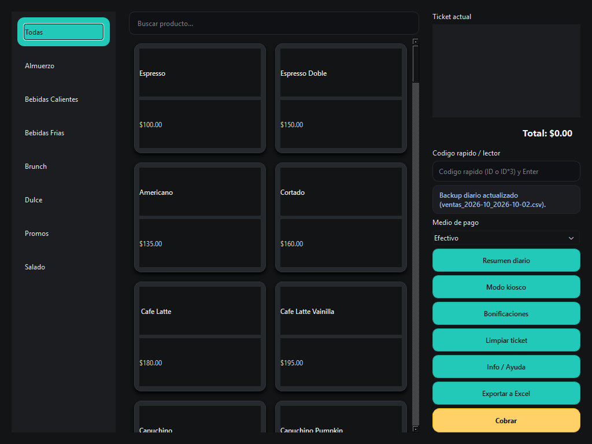

# Camelia POS

A point-of-sale desktop app built for a small café in Uruguay. It runs on the counter PC, fully offline: tap products into a ticket, apply discounts, take payment, print the ticket on a thermal printer, and close the day with an Excel summary.



> The UI and the user manual ([Manual_Camelia_POS.pdf](Manual_Camelia_POS.pdf)) are in Spanish, for the café staff. Product photos are the café's content and are not part of this repository; products without a photo render as text-only cards.

## The problem

The café was taking orders by hand. It needed something the staff could learn in minutes, that would keep working without internet, and that the owner could reconcile at the end of the day — on a modest counter PC with a 1024×768 screen and a thermal printer.

## Features

- **Product grid by category**, with search and a quick-entry box for barcode readers or keyboard: type `ITEM_ID` or `ITEM_ID*3` and Enter.
- **Editable ticket**: change quantities, remove items, discounts per product or for the whole ticket.
- **Payment confirmation** before a sale is saved, with the payment method.
- **Thermal ticket printing** over ESC/POS through the Windows spooler, with an automatic paper cut. The printer is the system default or the one named in `POS_PRINTER`.
- **Daily Excel summary** with totals per category, generated automatically or on demand.
- **Automatic daily backup** of the sales file.
- **Kiosk mode** (full screen) and keyboard shortcuts for every frequent action (`F1` lists them).
- **Portable**: a single `.exe` that creates its data folders next to itself. Copy the folder and it runs.

## Design decisions

**Plain files instead of a database.** Sales are appended to one CSV per month, products live in an editable CSV. For one counter PC this is easy to back up, easy for the owner to open in Excel, and has nothing to install or maintain. Each sale is written with `flush` + `fsync`, so a power cut loses at most the line being written.

**Offline by design.** No network, no server, no accounts. A café counter cannot stop selling because the internet is down, and a system with nothing exposed has nothing to attack remotely.

**Built for the staff, not for the developer.** Every failure ends in a visible status message for the cashier and a full traceback in `logs.txt`, which is created at startup so the staff can send it when something goes wrong. Invalid products in the CSV are skipped and reported instead of crashing the app.

**Fits the real screen.** The product grid computes its columns from the available width, so at the counter's 1024×768 it never needs horizontal scrolling.

## Getting started

Requirements: Windows, Python 3.10+.

```powershell
python -m pip install -r requirements.txt
python main.py
```

On first run the app creates `data/historial/` for monthly sales, backups and summaries. Products are read from `data/productos.csv` (`item_id,item_desc,categoria,precio,activo,imagen`).

### Build the executable

```powershell
pip install pyinstaller
pyinstaller --clean --name Camelia --onefile --noconsole --icon assets/icono.ico --add-data "data;data" --add-data "assets;assets" --version-file version_info.txt main.py
```

## Known limitations

| Situation | Current behavior |
|-----------|------------------|
| Two instances writing at the same time | Not supported: they could interleave writes to the same CSV. One counter, one instance. |
| Interrupted while saving a multi-line sale | Lines already written stay; there is no rollback. The confirmation step before saving reduces the window. |
| Products CSV edited with wrong headers or types | Invalid rows are skipped and reported; the Excel export may fail on malformed data. |
| Excel file open while exporting | The export fails with a clear error. |
| Ticket numbers | Restart every month, because they are tied to the monthly sales file. |
| Discounts | Any cashier can apply them; there is no supervisor approval. |

## License

[MIT](LICENSE)
